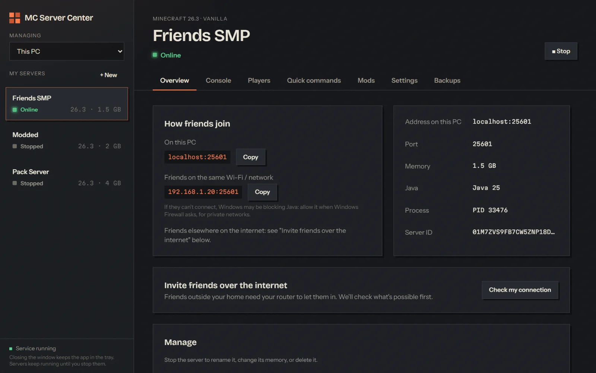
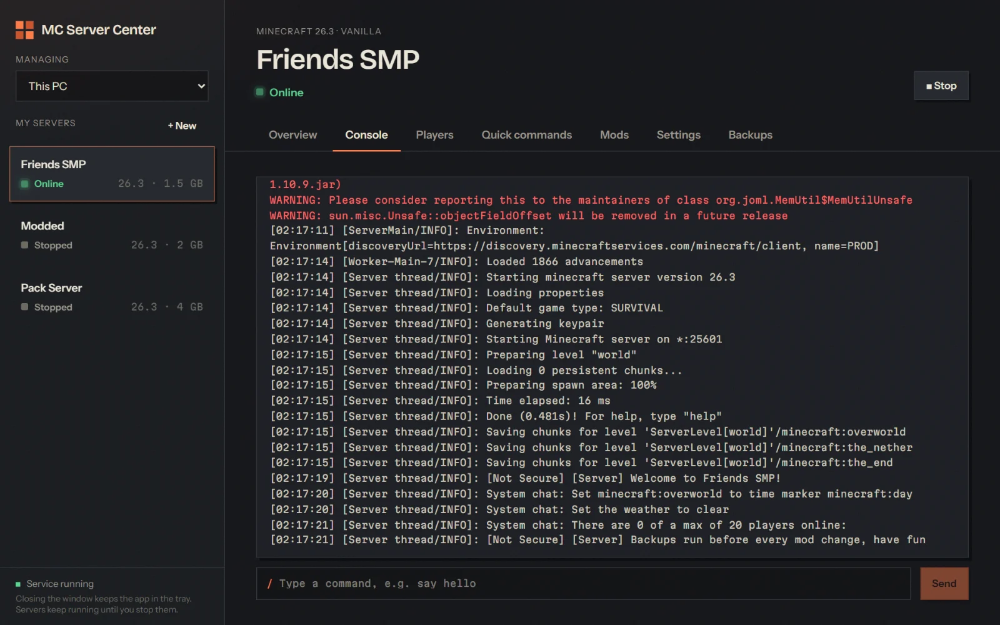
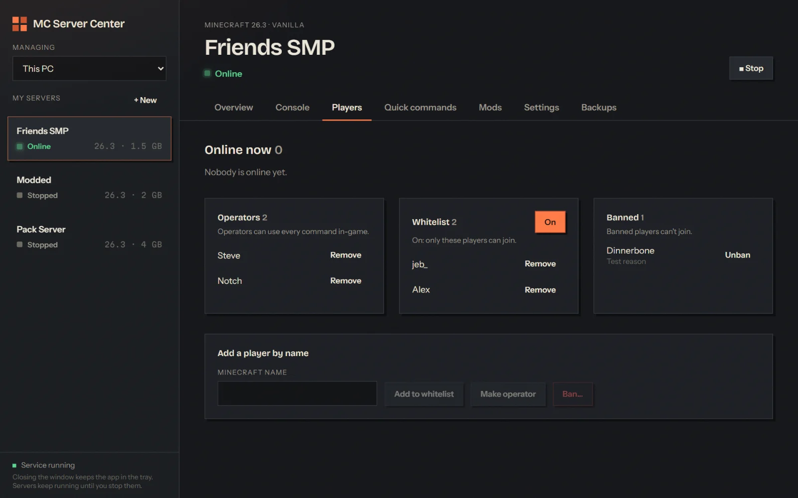
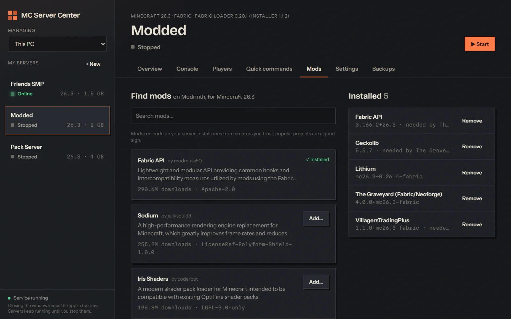
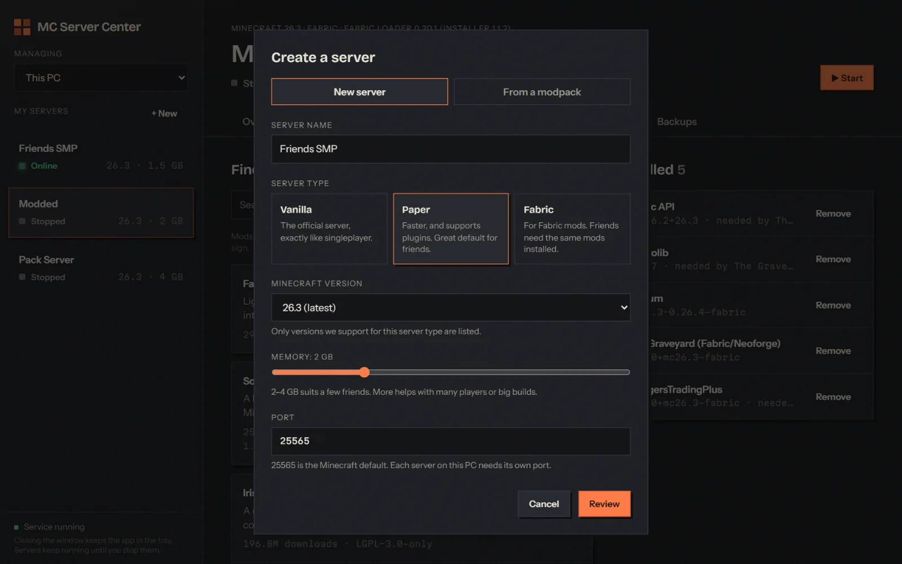
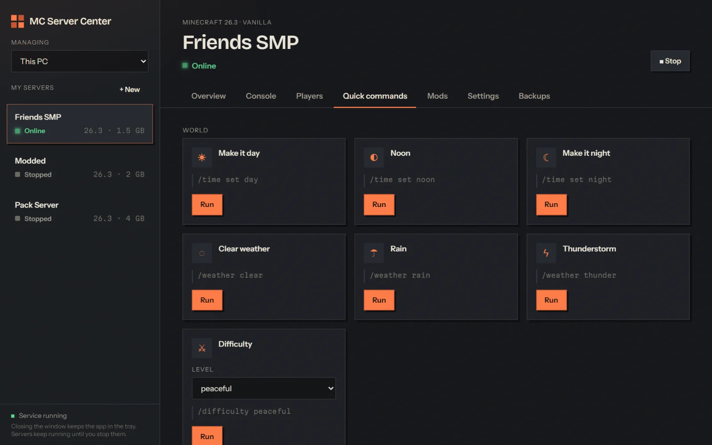
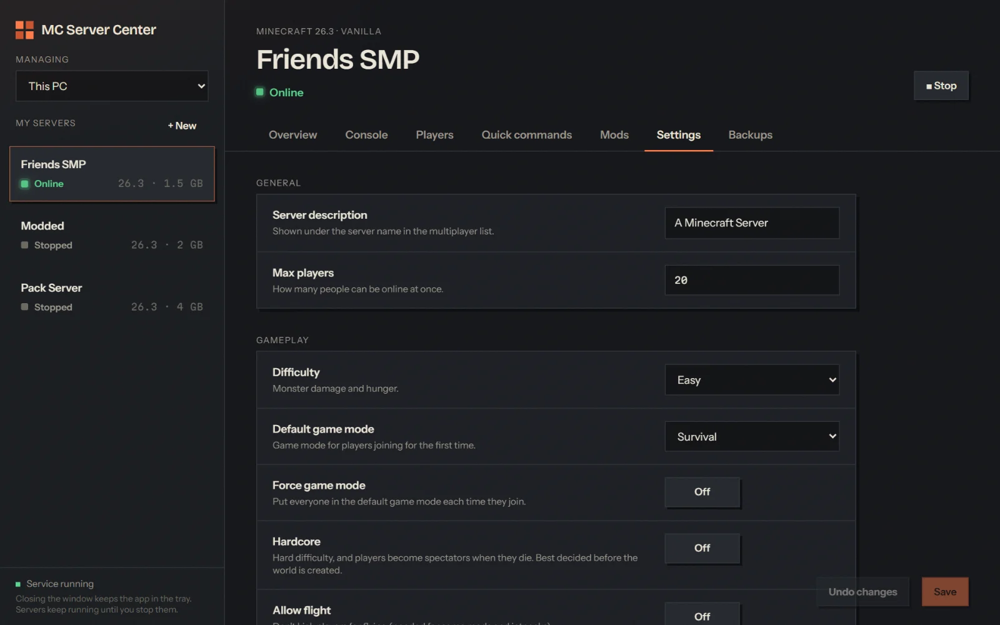
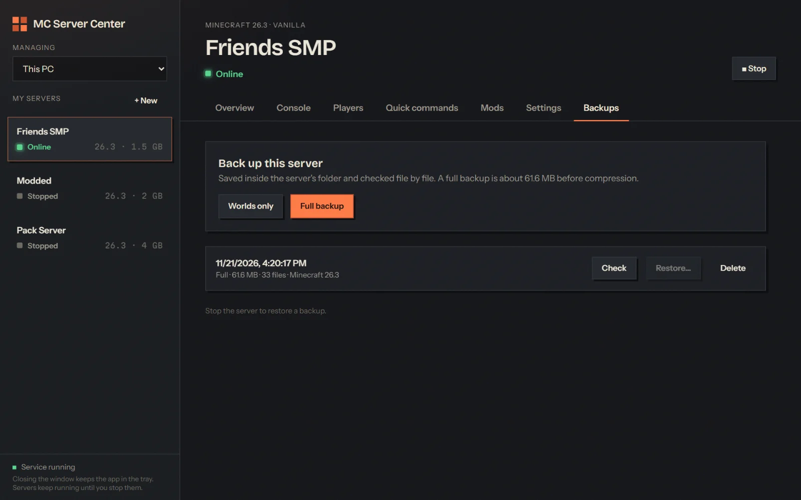
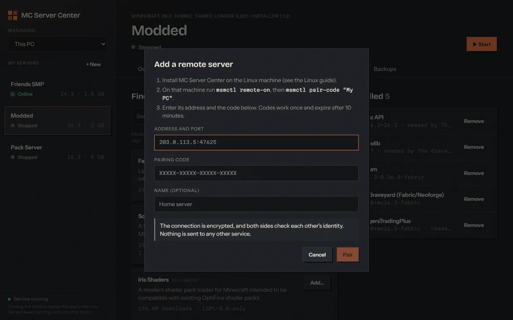
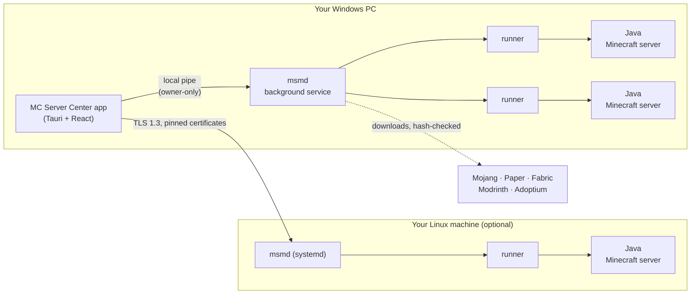

<div align="center">


# MC Server Center

**Create, run, mod, back up and share Minecraft: Java Edition servers for your friends, without a terminal.**

[](#license)

-FCC624.svg)


[**Download**](../../releases/latest) · [Features](#feature-tour) · [Linux hosting](#running-servers-on-a-linux-machine) · [Build from source](#building-from-source)

</div>

Free and open source. Runs on your Windows PC, or on your own Linux machine that you control from
the Windows app. You host everything yourself; this project runs no servers or accounts, and it
collects no telemetry.

> Not an official Minecraft product. Not approved by or associated with Mojang or Microsoft.



<table>
  <tr>
    <td></td>
    <td></td>
    <td></td>
  </tr>
  <tr>
    <td align="center">Live console</td>
    <td align="center">Players</td>
    <td align="center">Mods from Modrinth</td>
  </tr>
</table>

---

## Contents

- [Download and install](#download-and-install)
- [Your first server in two minutes](#your-first-server-in-two-minutes)
- [Feature tour](#feature-tour)
- [Letting friends join](#letting-friends-join)
- [Running servers on a Linux machine](#running-servers-on-a-linux-machine)
- [Command-line tool](#command-line-tool)
- [How it works](#how-it-works)
- [Security and privacy](#security-and-privacy)
- [Where your files are](#where-your-files-are)
- [Building from source](#building-from-source)
- [Making a release](#making-a-release)
- [Status and roadmap](#status-and-roadmap)
- [License](#license)

---

## Download and install

Open the [**Releases**](../../releases/latest) page and pick one file:

| You have | Download | Then |
|---|---|---|
| Windows 10 or 11 | `MCServerCenter-Setup-<version>-x64.exe` | Run it. No administrator rights are needed. Open **MC Server Center** from the Start menu. |
| Windows, no installer | `MCServerCenter-<version>-windows-x64-portable.zip` | Unzip anywhere and run `MC Server Center.exe`. Keep `msmd.exe` in the same folder. |
| A Linux server (headless) | `MCServerCenter-<version>-linux-x86_64.tar.gz` | See [Running servers on a Linux machine](#running-servers-on-a-linux-machine). |

**"Windows protected your PC"?** The builds are not code-signed yet, so SmartScreen warns about
any new program from an unknown publisher. Choose **More info → Run anyway**. Every release has a
`SHA256SUMS` file, and you can check a download with
`Get-FileHash .\MCServerCenter-Setup-*.exe` in PowerShell.

**Requirements**
- Windows 10 or 11, 64-bit. The WebView2 runtime is already part of Windows 10/11.
- Enough memory for your servers: 2–4 GB per small server for a few friends.
- You do **not** need to install Java. The app downloads the right version of Eclipse Temurin by
  itself, and keeps it in its own folder.

**Updating:** run the new installer. Your servers keep running during the update. When the
updated app opens, it hands over from the old background service to the new one, which picks the
running servers back up.

**Uninstalling:** stop your servers first (tray → *Stop all servers*). Then use *Settings → Apps*
in Windows. Your worlds and backups are **not** deleted; they stay in
[`%LOCALAPPDATA%\MinecraftServerManager`](#where-your-files-are) until you remove that folder
yourself.

---

## Your first server in two minutes



1. Click **+ New**, give the server a name, and pick a type:
   - **Vanilla**: the official server, exactly like singleplayer.
   - **Paper**: faster, and supports plugins. A good default for friends.
   - **Fabric**: for Fabric mods. Friends need the same mods installed.
   - Or choose **From a modpack** and pick any Modrinth modpack.
2. Pick the Minecraft version and memory, then click **Review → Create**. The app downloads the
   server and checks every file against the publisher's hash. It also installs Java if needed.
3. Read and accept the [Minecraft EULA](https://aka.ms/MinecraftEULA) when asked. The app never
   accepts it for you.
4. Click **▶ Start**. When the status shows **Online**, the **Overview** tab shows the address to
   give your friends.

Closing the window keeps the app in the system tray. **Your servers keep running** until you stop
them, even if you quit the app. The tray menu has **Stop all servers**.

---

## Feature tour

### Overview: how friends join
The address for this PC, the address for friends on your Wi-Fi (with a Copy button), and a guided
check for inviting friends over the internet ([details below](#letting-friends-join)). You can
also rename a server, change its memory, or delete it. Deleted servers go to a recoverable trash
folder.

### Console
The live server console, with history. Type a command such as `say hello` and press Enter. The
console still shows the earlier output after you close and reopen the app, and even after the
background service restarts.


### Players
Who's online, with **Kick**, **Ban**, **Op** and **De-op** buttons. You can manage the operators,
whitelist and ban lists, and add anyone by their Minecraft name. Changes apply instantly while
the server runs. While it's stopped, the app edits the server's files safely.


### Quick commands
One-click buttons for everyday things:
- day, noon or night;
- clear weather, rain or thunder;
- difficulty and a player's game mode;
- keep-inventory on or off;
- a broadcast message, and save the world.

You can also save your own **macros**: one or more commands, optionally with a player name or a
value to fill in. Each button shows the exact command before it runs.
Commands that differ between Minecraft versions are adjusted for you (for example, the
keep-inventory game rule was renamed in 1.21.11). Player names and values are checked, so a typo
can't turn into a different command.



### Mods and plugins (Modrinth)
Search [Modrinth](https://modrinth.com) for mods (Fabric) or plugins (Paper), filtered to your
server's Minecraft version:
- Dependencies are added automatically.
- Client-only mods that would crash a server are refused.
- Every download is hash-checked.
- A **safety snapshot** is saved in Backups before any change, so you can always go back.

**Modpacks:** *+ New → From a modpack* turns a Modrinth modpack into a working server in one step.
It skips the client-only files and tells you which pack your friends need to install.


### Settings
The common `server.properties` options with plain-language descriptions:
- server description, max players;
- difficulty, game mode, hardcore, flight;
- whitelist, view and simulation distance, spawn protection, idle timeout, and more.

Values are checked before saving, and earlier versions of the file are kept. Passwords and
secrets in the file are never shown.



### Backups
- **Full** or **worlds-only** backups, even while the server is running: the app pauses saving
  and flushes the world first.
- Each backup is a normal ZIP with a checksum for every file. **Check** verifies it at any time.
- **Restore** never deletes anything: your current files are moved aside first.
- Free disk space is checked before starting.



### When something goes wrong
If a server crashes or won't start, the app explains why in plain language, quotes the log line
that proves it, and offers a fix button where one exists. It recognises:
- the wrong Java version;
- a port already in use;
- not enough memory;
- the EULA not accepted;
- broken or incompatible mods;
- a damaged world.

---

## Letting friends join

| Where your friends are | What to do |
|---|---|
| Same PC | `localhost:<port>` |
| Same Wi-Fi / home network | The LAN address shown on **Overview** (for example `192.168.1.20:25565`). If they can't connect, allow Java when Windows Firewall asks, for private networks. |
| Anywhere on the internet | Click **Check my connection** on the Overview tab. |

**Check my connection** does the following:

1. Finds your public address. It also detects **carrier-grade NAT** (CGNAT), where your internet
   provider shares one address between many homes. Port forwarding can't work in that case, and
   the app tells you so.
2. With your permission, it can:
   - add a Windows Firewall rule for just this server's port (Windows asks for administrator
     approval);
   - ask your router to forward the port automatically (UPnP), if the router supports it.
   - If neither works, it shows manual port-forwarding steps for your router.
3. With your consent, runs an **outside test**: a public checker tries to reach your server from
   the internet.
4. Gives you the address to share.

Nothing on your PC or router is changed unless you click the button for it.

---

## Running servers on a Linux machine

You can run your servers on an always-on Linux box (a home server or a rented VPS) and manage it
from the Windows app.

### Install

On the Linux machine (x86_64, systemd; tested target Ubuntu 24.04):

```sh
tar -xzf MCServerCenter-<version>-linux-x86_64.tar.gz
cd MCServerCenter-<version>-linux-x86_64
sha256sum -c ../SHA256SUMS --ignore-missing   # optional: check the download
sudo ./install.sh
```

The installer:
- creates an unprivileged `msm` user;
- installs `msmd` and `msmctl` to `/usr/local/bin`;
- installs a hardened systemd service, `msmd`, that keeps its data in `/var/lib/msm`.

Re-running it upgrades the service without stopping your Minecraft servers.

### Pair the Windows app

```sh
sudo -u msm msmctl --data-dir /var/lib/msm remote-on 47625      # allow remote control on TCP 47625
sudo ufw allow 47625/tcp                                        # if you use ufw
sudo -u msm msmctl --data-dir /var/lib/msm pair-code "My PC"    # prints a one-time code
```

In the app, open the **Managing** menu at the top left, choose **+ Add a remote server**, and
enter `your-server-address:47625` and the code. From then on, every screen works on that machine.
Switch back to **This PC** from the same menu.



- The connection is encrypted (TLS 1.3).
- Both sides pin each other's certificate, so a machine in between can't impersonate either one.
- Pairing codes work once and expire after 10 minutes.
- A paired PC can do everything except pairing or removing other devices.

To see paired devices or revoke one (it is disconnected immediately):

```sh
sudo -u msm msmctl --data-dir /var/lib/msm devices
sudo -u msm msmctl --data-dir /var/lib/msm revoke <device-id>
```

More detail: [`packaging/linux/README.md`](packaging/linux/README.md).

---

## Command-line tool

`msmctl` comes with every download. It talks to the same background service as the app, which
makes it handy on headless machines and for scripts:

```text
msmctl [--data-dir DIR] [--host HOST:PORT] <command>
  ping | info | versions [vanilla|paper|fabric] | java | list
  create <name> <mc_version> <port> <memory_mb> [vanilla|paper|fabric]
  eula <server>                      accept the Minecraft EULA (https://aka.ms/MinecraftEULA)
  start <server> | stop <server> | kill <server>
  send <server> <command...>         run one console command
  console <server>                   stream the console; type commands to send them
  players <server> | op | deop | kick | ban | pardon | wl-add | wl-remove <server> <name>
  mods <server> | mods-search <server> <query> | mods-add | mods-rm
  packs <query> | pack-install <project> <name> <port> <memory_mb>
  backups <server> | backup <server> [full|world] | verify | restore
  diagnose <server> | net <server> | quick <server> | run <server> <command-id> ...
  remote-on [port] [bind] | remote-off | remote-status | pair-code [name] | devices | revoke <id>
  remote-pair <host:port> <CODE> [name]      then: msmctl --host <host:port> <command>
  call <api.command> [json]          raw API call (for scripting and debugging)
```

`<server>` is the server's ID from `msmctl list`.

---

## How it works



- **`msmd`**, the background service, does all the work:
  - installs and updates servers, Java and mods;
  - takes backups and diagnoses problems;
  - checks every request. The app only shows things and sends requests.
- Each Minecraft server runs under its own small **runner** process. The runner keeps the server
  alive while the service restarts or upgrades, and buffers its console. When the service comes
  back, it re-attaches to the runner.
- **Downloads** only come over HTTPS from the official sources (Mojang, PaperMC, FabricMC,
  Modrinth, Adoptium). Redirects to other hosts are refused. Files are checked against the
  publisher's hash, and verified files are cached and shared between servers.
- Everything is stored locally in SQLite plus ordinary folders. Each server is a normal server
  folder that you can open, copy or move.


---

## Security and privacy

- **No accounts, no cloud, no telemetry.** The only network traffic is:
  - downloads from the official sources listed above;
  - Modrinth searches;
  - the public-IP and outside checks, which run only when you click them;
  - connections to Linux machines you paired yourself.
- **Local access:** the service listens on a named pipe (Windows) or a Unix socket (Linux) that
  only your user account can open, and it checks the caller's identity.
- **Remote access** is off by default. When on, it uses mutual TLS 1.3 with pinned certificates.
  Pairing uses one-time 100-bit codes, and the code proof is bound to both certificates. Failed
  attempts are rate-limited, every device has its own permissions, and revoking a device cuts
  its connection immediately.
- **Server files:** every file operation is confined to the server's own folder, including
  symlink and `..` tricks, and modpack contents are validated before extraction.
- **Mods run code on your machine.** Only install mods from creators you trust. The app shows
  download counts and authors to help you decide.
- **Console commands** from buttons are built from checked templates, so a player name can't
  inject a second command.

Found a security problem? Please report it privately (GitHub → *Security* → *Report a
vulnerability*) rather than in a public issue.

---

## Where your files are

| | Windows | Linux service | Linux (your user) |
|---|---|---|---|
| Everything | `%LOCALAPPDATA%\MinecraftServerManager` | `/var/lib/msm` | `~/.local/state/msm` |
| Servers (worlds, mods, configs) | `…\instances\<id>\server` | `…/instances/<id>/server` | same |
| Backups | `…\instances\<id>\backups` | same | same |
| Java runtimes | `…\runtimes\java` | same | same |
| Logs | `…\logs` | same | same |

The desktop app keeps its own identity and list of paired machines in
`%APPDATA%\dev.msm.desktop`.

---

## Building from source

**You need:**
- [Rust](https://rustup.rs). The pinned version in `rust-toolchain.toml` installs itself.
- Node.js 22+ and [pnpm](https://pnpm.io) 10.
- On Windows, the MSVC build tools (Visual Studio Build Tools with *Desktop development with C++*).

### Run the app in development mode

```sh
cargo build -p msmd -p msmctl            # the background service + CLI
cd apps/desktop
pnpm install
pnpm tauri dev                           # opens the app; it starts msmd for you
```

If a `msmd.exe` from an older build is still running, end it in Task Manager first. The app
connects to whichever service is already running.

### Build the installer locally (Windows)

```sh
cargo build --release -p msmd -p msmctl
cd apps/desktop
pnpm install
node scripts/stage-sidecar.mjs           # puts msmd next to the app in the bundle
pnpm tauri build --config src-tauri/tauri.release.conf.json
# -> target/release/bundle/nsis/MC Server Center_<version>_x64-setup.exe
```

### Checks (the same as CI)

```sh
cargo fmt --all --check
cargo clippy --workspace --all-targets -- -D warnings
cargo test --workspace
cd apps/desktop && pnpm typecheck
```

### Preview the UI in a browser

`apps/desktop/scripts/ui-bridge.mjs` serves the built UI to an ordinary browser, connected to a
running `msmd`. The README screenshots were taken this way:

```sh
cd apps/desktop && pnpm build
node scripts/ui-bridge.mjs --data-dir "%LOCALAPPDATA%\MinecraftServerManager"
# open http://127.0.0.1:1430
```

### Repository layout

| Path | Purpose |
|---|---|
| `crates/msm-core` | Domain types, IDs, error codes, server state machine (pure, no I/O) |
| `crates/msm-fsguard` | Path confinement and safe file operations (security boundary) |
| `crates/msm-storage` | SQLite storage and migrations |
| `crates/msm-api` | Versioned protocol types shared by the service and clients |
| `crates/msm-transport` | Local IPC, remote TLS and pairing (security boundary) |
| `crates/msm-providers` | Download engine and upstream adapters (Mojang, Paper, Fabric, Modrinth, Adoptium) |
| `crates/msm-engine` | Application services: install, run, backups, mods, diagnostics, network |
| `apps/msmd` | The background service (and the per-server runner) |
| `apps/msmctl` | Command-line client |
| `apps/desktop` | Tauri 2 + React desktop app |
| `packaging/linux` | systemd unit, installer and Linux guide |

---

## Making a release

1. Set the same version in `Cargo.toml` (`[workspace.package] version`),
   `apps/desktop/src-tauri/tauri.conf.json` and `apps/desktop/package.json`.
2. Commit, then tag and push:
   ```sh
   git tag v0.1.0
   git push origin v0.1.0
   ```
3. The [Release workflow](.github/workflows/release.yml) builds the Windows installer, the
   portable zip and the Linux package. It then publishes a GitHub Release with all three files
   and `SHA256SUMS`.

To test the build without publishing, open *Actions → Release → Run workflow*. The files are
attached to the run as artifacts.

---

## Status and roadmap

Working today:
- **Server types:** Vanilla, Paper and Fabric (Minecraft 1.18.2 to the latest), and Modrinth
  modpacks (Fabric).
- **Java:** installed and managed automatically.
- **Running servers:** console, players, quick commands and macros, settings.
- **Content and data:** mods and plugins, backups and restore, crash diagnosis.
- **Friends and remote access:** the connection helper, firewall/UPnP, remote Linux management
  with pairing.
- **Desktop:** tray icon, and servers that survive app and service restarts.
- **Tests:** 174 automated tests.

Not done yet:
- **Server types:** Forge and NeoForge servers and modpacks.
- **Friends behind CGNAT:** a self-hosted relay you run on your own VPS.
- **Custom domains:** via Cloudflare DNS.
- **Backups:** scheduled, automatic.
- **Distribution:** code-signed builds and automatic updates.
- **Secrets:** storage in Windows Credential Manager. Today they are files readable only by your
  user.
- **Desktop:** macOS and Linux desktop builds. The Linux *service* is supported.

---

## License

Licensed under either of [Apache License, Version 2.0](LICENSE-APACHE) or
[MIT license](LICENSE-MIT), at your option. Unless you explicitly state otherwise, any
contribution intentionally submitted for inclusion in this project shall be dual licensed as
above, without any additional terms.

Minecraft is a trademark of Mojang Synergies AB. This project is not affiliated with Mojang or
Microsoft. Each server you create downloads the official server software directly from its
publisher, and you must accept the [Minecraft EULA](https://aka.ms/MinecraftEULA) to run it.
